 # Hi, I'm Daff404

  

---

## Tech Stack

   
   
   
   
   
   
  

---

## Frontend

  

## Backend

  

## Database

  

---

## GitHub Analytics

  
  

---

## Activity

  

---

## Contact

  
  

---

  

